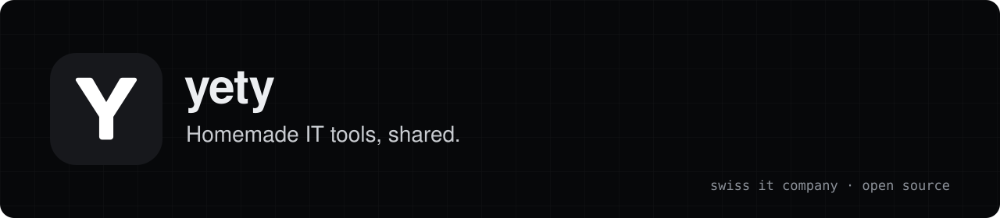

<h3>We are sysadmins in Switzerland. When something gets in our way, we build a tool and share it.</h3>

 

<table>
<tr>
<td width="33%" align="center" valign="top">
 

<h3><a href="https://github.com/yetysw/mccb">mccb</a></h3>

Migrate Outlook PST and OST mailboxes to IMAP, CalDAV and CardDAV from a web dashboard, with pause and resume.

<a href="https://github.com/yetysw/mccb"><b>Repository</b></a>

</td>
<td width="33%" align="center" valign="top">
 

<h3><a href="https://github.com/yetysw/jade">Jade</a></h3>

A local-first document assistant for companies. Ask questions about your own documents.

<a href="https://github.com/yetysw/jade"><b>Repository</b></a>

</td>
<td width="33%" align="center" valign="top">
 

<h3><a href="https://github.com/yetysw/config-auto-messagerie">Mail Setup</a></h3>

A self-hosted, white-label wizard that guides users through setting up mail, calendar and contacts on their devices.

<a href="https://github.com/yetysw/config-auto-messagerie"><b>Repository</b></a>

</td>
</tr>
</table>

 

YETY is an IT company in Switzerland. We work with open-source software every day and we love it. 
The tools we build to make our own work simpler are free and open source, for anyone to use.

 

<a href="mailto:hello@yety.ch">hello@yety.ch</a>

